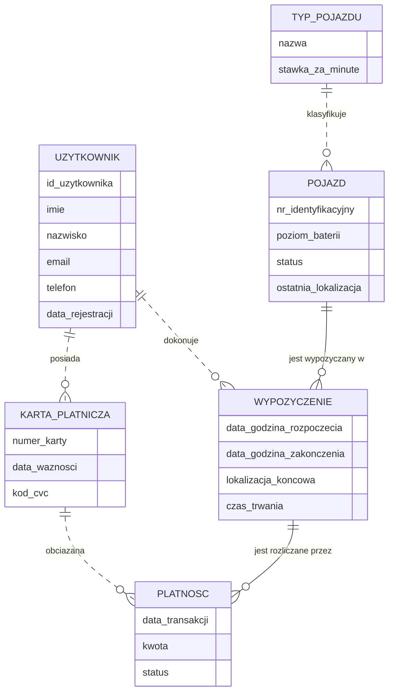

# MobiGo — konceptualny diagram ERD

Źródło: `reality.md`. Plan i decyzje: `plan-erd.md`.

## 1. Cel i poziom modelu

Model **konceptualny** rzeczywistości biznesowej MobiGo (wynajem rowerów elektrycznych i hulajnóg na minuty).
Brak kluczy obcych, typów SQL, tabel pośrednich/technicznych i indeksów.

Notacja: Mermaid `erDiagram` (crow's foot).

| Symbol | Znaczenie |
|---|---|
| `\|\|` | dokładnie 1 |
| `o{` | 0..N |
| `--` (linia ciągła) | związek identyfikujący (encja po stronie N jest słaba) |
| `..` (linia przerywana) | związek nieidentyfikujący |

Diagram pokazuje tylko nazwy atrybutów. Dziedziny pojęciowe (`tekst`, `data`, `dataczas`, `kwota`, `procent`, `gps`,
`status`, `identyfikator`, `minuty`), identyfikatory (PK), unikalność (UK) i źródła (Z#) są w tabeli atrybutów (sekcja 4).

## 2. Diagram

## 3. Słownik encji

| Encja | Definicja | Pokrycie | Synonimy w opisie |
|---|---|---|---|
| UZYTKOWNIK | Osoba zarejestrowana w aplikacji mobilnej MobiGo, logująca się adresem e-mail. | Z2–Z5 | — |
| KARTA_PLATNICZA | Karta dodana przez użytkownika do opłacania przejazdów. | Z6–Z8 | „metoda płatności”, „karta kredytowa” (N11) |
| TYP_POJAZDU | Rodzaj pojazdu (rower elektryczny / hulajnoga) wraz z obowiązującą dla niego stawką za minutę. | Z9, Z11, Z18 | „typ”, „cennik” → `TYP_POJAZDU.stawka_za_minute` |
| POJAZD | Konkretny rower elektryczny lub hulajnoga rozmieszczony w mieście. | Z9–Z11 | „kod QR” → `POJAZD.nr_identyfikacyjny` |
| WYPOZYCZENIE | Pojedynczy przejazd: użycie danego pojazdu przez danego użytkownika od rozpoczęcia do zakończenia. | Z12–Z15 | „przejazd”, „wynajem” |
| PLATNOSC | Rekord obciążenia karty za zakończone wypożyczenie. | Z17–Z20 | „transakcja” |

## 4. Atrybuty

| Encja | Atrybut | Dziedzina | Marker | Pokrycie / uwagi |
|---|---|---|---|---|
| UZYTKOWNIK | id_uzytkownika | identyfikator | PK | Z5 |
| | imie, nazwisko, telefon | tekst | | Z3 |
| | email | tekst | UK | Z3, Z4 (login) |
| | data_rejestracji | data | | Z5 |
| KARTA_PLATNICZA | numer_karty | tekst | PK | Z7; założenie A1 |
| | data_waznosci | data | | Z7 |
| | kod_cvc | tekst | | Z7; nieścisłość N1 (PCI DSS) |
| TYP_POJAZDU | nazwa | tekst | PK | Z11 (rower / hulajnoga) |
| | stawka_za_minute | kwota | | Z18 |
| POJAZD | nr_identyfikacyjny | identyfikator | PK | Z10 (= kod QR, jeden atrybut) |
| | poziom_baterii | procent | | Z11 |
| | status | status | | Z11 (dostępny / wypożyczony / w serwisie) |
| | ostatnia_lokalizacja | gps | | Z11; atrybut złożony (szerokość, długość) |
| WYPOZYCZENIE | data_godzina_rozpoczecia | dataczas | PK | Z13; założenie A2 (klucz częściowy) |
| | data_godzina_zakonczenia | dataczas | | Z15; pusta dla trwającego wypożyczenia |
| | lokalizacja_koncowa | gps | | Z15; atrybut złożony |
| | czas_trwania | minuty | | Z18; **atrybut pochodny** = zakończenie − rozpoczęcie |
| PLATNOSC | data_transakcji | dataczas | PK | Z19; założenie A3 (klucz częściowy); nieścisłość N9 |
| | kwota | kwota | | Z19 |
| | status | status | | Z19 (udana / nieudana) |

## 5. Związki i liczności

| # | Mermaid | Liczności (min/max) i uzasadnienie | Pokrycie |
|---|---|---|---|
| R1 | `UZYTKOWNIK \|\|..o{ KARTA_PLATNICZA : posiada` | Karta → dokładnie 1 użytkownik (karta jest dodawana przez konkretnego użytkownika, A1). Użytkownik → 0..N kart: konto powstaje przy rejestracji, karta dopiero „po zalogowaniu”; wymóg posiadania karty to reguła B2, „jedną lub więcej” to max N. | Z6, Z7 |
| R2 | `UZYTKOWNIK \|\|..o{ WYPOZYCZENIE : dokonuje` | Wypożyczenie → dokładnie 1 użytkownik („który użytkownik”). Użytkownik → 0..N (nowy użytkownik nie ma przejazdów; może mieć wiele). | Z13 |
| R3 | `POJAZD \|\|--o{ WYPOZYCZENIE : "jest wypozyczany w"` | Identyfikujący (A2). Wypożyczenie → dokładnie 1 pojazd („który pojazd”). Pojazd → 0..N (nowy pojazd nie był wypożyczany; w czasie wiele razy). | Z13 |
| R4 | `TYP_POJAZDU \|\|..o{ POJAZD : klasyfikuje` | Pojazd → dokładnie 1 typ (rower/hulajnoga). Typ → 0..N pojazdów (typ i stawka mogą istnieć przed wprowadzeniem pojazdów). | Z11, Z18 |
| R5 | `WYPOZYCZENIE \|\|--o{ PLATNOSC : "jest rozliczane przez"` | Identyfikujący (A3). Płatność → dokładnie 1 wypożyczenie. Wypożyczenie → 0..N: 0 dla trwającego (B5), N — możliwe ponowienia po statusie „nieudana” (N2). | Z17, Z20 |
| R6 | `KARTA_PLATNICZA \|\|..o{ PLATNOSC : obciazana` | Płatność → dokładnie 1 karta („wybraną metodą płatności”). Karta → 0..N płatności. | Z20 |

Brak związków N:M — encje asocjacyjne nie są potrzebne (WYPOZYCZENIE już łączy UZYTKOWNIK i POJAZD).

## 6. Reguły biznesowe

Reguły mają pokrycie w opisie, ale nie da się ich wyrazić na diagramie.

- **B1** E-mail użytkownika jest unikalny i służy jako login (Z4).
- **B2** Wypożyczenie wymaga posiadania przez użytkownika co najmniej 1 karty (Z6).
- **B3** Rozpoczęcie wypożyczenia → status pojazdu „wypożyczony” (Z14); zakończenie → „dostępny” (Z16).
- **B4** `PLATNOSC.kwota` = `WYPOZYCZENIE.czas_trwania` × `TYP_POJAZDU.stawka_za_minute` typu wypożyczonego pojazdu (Z18).
- **B5** Płatność powstaje dopiero po zakończeniu wypożyczenia (Z17).
- **B6** Karta obciążana płatnością musi należeć do użytkownika, który dokonał wypożyczenia (Z20) — ograniczenie cyklu UZYTKOWNIK → WYPOZYCZENIE → PLATNOSC → KARTA_PLATNICZA → UZYTKOWNIK.
- **B7** `data_godzina_zakonczenia` > `data_godzina_rozpoczecia`.

## 7. Założenia

- **A1** KARTA_PLATNICZA jest identyfikowana numerem karty — ta sama karta nie występuje u dwóch użytkowników.
- **A2** WYPOZYCZENIE jest identyfikowane przez POJAZD + `data_godzina_rozpoczecia` (pojazd nie może mieć dwóch wypożyczeń rozpoczętych w tej samej chwili) → encja słaba, związek R3 z POJAZD identyfikujący.
- **A3** PLATNOSC jest identyfikowana przez WYPOZYCZENIE + `data_transakcji` → encja słaba, związek R5 identyfikujący. Pełny identyfikator płatności: `nr_identyfikacyjny` pojazdu + `data_godzina_rozpoczecia` + `data_transakcji`.
- Pozostałe związki (R1, R2, R4, R6) są nieidentyfikujące.
- Jedyny sztuczny identyfikator to `id_uzytkownika` — ma pokrycie w Z5; innych `id_*` nie dodano.
- **Konwencja dziedzin:** atrybuty mają dziedziny pojęciowe (`tekst`, `data`, `dataczas`, `kwota`, `procent`, `gps`, `status`, `identyfikator`, `minuty`), a nie typy SQL — model pozostaje konceptualny. Dziedziny są tylko w tabeli atrybutów, nie na diagramie.

## 8. Nieścisłości

Pytania do klienta. N1–N8 ustalone w planie, N9+ znalezione podczas implementacji.

| # | Opis | Źródło | Wpływ na model | Pytanie do klienta |
|---|---|---|---|---|
| N1 | Przechowywanie kodu CVC jest sprzeczne z PCI DSS. | Z7, Z8 | `kod_cvc` zostaje, bo ma pokrycie w opisie. | Czy CVC ma być przechowywany, czy tylko podawany przy autoryzacji karty? |
| N2 | Brak reguły ponawiania nieudanej płatności. | Z19, Z20 | R5 ma liczność 0..N zamiast 0..1. | Czy po statusie „nieudana” system ponawia płatność (tą samą lub inną kartą)? |
| N3 | Nieokreślony sposób zaokrąglania czasu przejazdu. | Z18 | Dotyczy B4 i `czas_trwania`; struktura modelu bez zmian. | Czy naliczane są minuty rozpoczęte, czy pełne? |
| N4 | „Cennik obowiązujący” może sugerować historię cen. | Z18 | Model trzyma tylko bieżącą `stawka_za_minute` w TYP_POJAZDU. | Czy stawki zmieniają się w czasie i czy trzeba znać stawkę z dnia przejazdu? |
| N5 | Nie wiadomo, czy `lokalizacja_koncowa` aktualizuje `ostatnia_lokalizacja` pojazdu. | Z11, Z15 | Brak reguły — tylko pytanie. | Czy po zakończeniu przejazdu ostatnia znana lokalizacja pojazdu = lokalizacja końcowa? |
| N6 | Nie wiadomo, czy można wypożyczyć pojazd o statusie innym niż „dostępny”. | Z11, Z12 | Brak reguły — tylko pytanie. | Czy skan QR pojazdu „w serwisie” / „wypożyczony” ma być odrzucany? |
| N7 | Nie wiadomo, czy użytkownik może mieć kilka wypożyczeń jednocześnie. | Z13 | R2 0..N dopuszcza obie interpretacje. | Czy jeden użytkownik może jednocześnie wypożyczać kilka pojazdów? |
| N8 | Los karty wygasłej/usuniętej, do której przypisane są historyczne płatności. | Z7, Z20 | R6 wymaga dokładnie 1 karty dla płatności. | Czy kartę z historią płatności można usunąć? Co wtedy z płatnościami? |
| N9 | Opis mówi o „dacie transakcji”, plan nadaje jej dziedzinę `dataczas`. | Z19 | Przyjęto `dataczas` wg planu; przy samej dacie A3 wykluczałby dwie próby płatności za to samo wypożyczenie tego samego dnia (N2). | Czy rejestrowana jest też godzina transakcji? |
| N10 | Mermaid nie ma notacji klucza częściowego encji słabej — `PK` przy `data_godzina_rozpoczecia` i `data_transakcji` (sekcja 4) oznacza tylko dyskryminator. | plan krok 3, A2, A3 | Pełny identyfikator wynika z linii ciągłej `--` (R3, R5); opisane w A2/A3. | — (ograniczenie notacji, nie pytanie do klienta) |
| N11 | Opis mówi o „kartach kredytowych”, plan nazywa encję KARTA_PLATNICZA (pojęcie szersze). | Z7 | Nazwa encji wg planu; struktura bez zmian. | Czy akceptowane są tylko karty kredytowe, czy też debetowe? |

## 9. Macierz pokrycia

| Zdanie | Treść (skrót) | Elementy modelu |
|---|---|---|
| Z1 | Wynajem rowerów i hulajnóg na minuty | POJAZD, TYP_POJAZDU, WYPOZYCZENIE, `stawka_za_minute` |
| Z2 | Rejestracja w aplikacji | UZYTKOWNIK |
| Z3 | Imię, nazwisko, e-mail, telefon | `imie`, `nazwisko`, `email`, `telefon` |
| Z4 | E-mail unikalny, login | `email` UK, B1 |
| Z5 | Unikalny identyfikator, data rejestracji | `id_uzytkownika` PK, `data_rejestracji` |
| Z6 | Musi dodać metodę płatności | KARTA_PLATNICZA, R1, B2 |
| Z7 | Jedna lub więcej kart: numer, ważność, CVC | KARTA_PLATNICZA, R1 (0..N), `numer_karty`, `data_waznosci`, `kod_cvc`, A1, N1, N8, N11 |
| Z8 | Bezpieczne przechowywanie | brak elementu — wymaganie niefunkcjonalne, poza modelem konceptualnym; N1 |
| Z9 | Pojazdy: rowery i hulajnogi | POJAZD, TYP_POJAZDU |
| Z10 | Unikalny numer = kod QR | `nr_identyfikacyjny` PK |
| Z11 | Typ, bateria, status, lokalizacja GPS | R4, `nazwa`, `poziom_baterii`, `POJAZD.status`, `ostatnia_lokalizacja`, N5, N6 |
| Z12 | Skan QR rozpoczyna wypożyczenie | WYPOZYCZENIE, `nr_identyfikacyjny`, N6 |
| Z13 | Kto, który pojazd, start | R2, R3, `data_godzina_rozpoczecia`, A2, N7 |
| Z14 | Status → „wypożyczony” | B3 |
| Z15 | Koniec: data i godzina, lokalizacja końcowa | `data_godzina_zakonczenia`, `lokalizacja_koncowa`, B7, N5 |
| Z16 | Status → „dostępny” | B3 |
| Z17 | Po zakończeniu powstaje płatność | PLATNOSC, R5, B5 |
| Z18 | Koszt = czas × stawka typu | `stawka_za_minute`, `czas_trwania`, R4, B4, N3, N4 |
| Z19 | Kwota, data transakcji, status | `kwota`, `data_transakcji`, `PLATNOSC.status`, A3, N2, N9 |
| Z20 | Płatność ↔ wypożyczenie i metoda płatności | R5, R6, B6, N8 |

## 10. Log decyzji

| Decyzja | Odrzucone warianty | Uzasadnienie |
|---|---|---|
| Stawka w TYP_POJAZDU | osobna encja CENNIK; sama reguła bez atrybutu | Stawka potrzebuje miejsca w modelu, a opis nie daje cennikowi własnej tożsamości ani historii (N4). |
| KARTA_PLATNICZA | METODA_PLATNOSCI; nadtyp z podtypami | Opis zna tylko karty; „metoda płatności” to synonim. |
| Lokalizacja jako atrybut złożony | encja LOKALIZACJA | Współrzędne nie mają własnej tożsamości ani związków. |
| Dziedziny pojęciowe | typy SQL | Model ma zostać konceptualny. |
| Diagram tylko z nazwami atrybutów | dziedzina, PK/UK i Z# na diagramie | Decyzja użytkownika — czytelność; szczegóły w sekcji 4. Mermaid wymaga drugiego tokenu, więc jest nim niewidoczna spacja U+200B, a pusta kolumna jest ukryta przez `themeCSS`. |
| Identyfikatory naturalne A1–A3 | sztuczne `id_*` | Brak pokrycia w opisie dla identyfikatorów innych niż `id_uzytkownika`. |
| `kod_cvc` zostaje + N1 | usunięcie atrybutu | Ma pokrycie w Z7; konflikt z praktyką (PCI DSS) zgłoszony jako nieścisłość. |
| `czas_trwania` jako atrybut pochodny | atrybut zapisywany; brak atrybutu | Potrzebny w B4, wyliczalny z dat rozpoczęcia i zakończenia. |
| R1 0..N + B2 | R1 1..N | Konto istnieje przed dodaniem karty (karta „po zalogowaniu”). |
| R5 0..N + N2 | R5 0..1 | Status „nieudana” sugeruje możliwość ponowień. |
| N5, N6 jako nieścisłości | reguły biznesowe | Brak pokrycia w opisie. |
